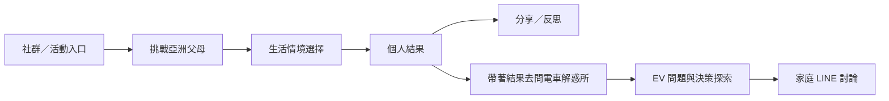
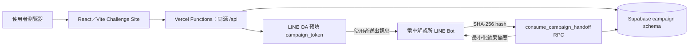

# 👨‍👩‍👧 挑戰亞洲父母

### 當「想換電動車」遇上亞洲家庭的每一句「可是……」

> **From EV curiosity to family consensus.**<br>
> 從「我想買電動車」，一路陪使用者走到「我們家可以一起討論」。

「挑戰亞洲父母」是這段旅程的 **engagement layer**：以低門檻、mobile-first 的家庭情境互動，讓原本難以開始的購車對話有個入口；完成後，使用者可分享結果，或帶著精簡結果脈絡前往 LINE「電車解惑所」，繼續探索 EV 決策問題。

**挑戰亞洲父母：讓家庭購車議題有一個願意開始的入口。**<br>
**電車解惑所：讓開始之後的每個疑問，都有辦法繼續談下去。**

[開始挑戰](https://asian-parents-challenge.vercel.app) · [查看電車解惑所](https://github.com/WhiteChocolate0/toyota-ev-linebot)

> Demo 備註：2026-10-07 對正式首頁取得 HTTP 200；此檢查只確認首頁可連線，不代表本 README 中所有社交或 LINE handoff 功能均已完成線上驗收。

## 為什麼從「亞洲父母」開始？

這不是把父母當成需要被說服的反派，而是從跨世代溝通與家庭決策出發。高單價汽車選擇常牽涉家庭資金、使用習慣、品牌信任、安全感與長期經驗；EV 討論也可能從「充電方便嗎？」「電池維修怎麼辦？」開始。真正的旅程往往不是看廣告就買車，而是產生興趣、自己研究、回家討論、遇到疑慮，再找資料，最後才形成決策。

## 我們不是在做心理測驗，而是在設計一個入口

### 01｜先讓人願意玩

15 題、三階段、匿名免登入的手機互動；用熟悉的家庭情境降低開始成本。

### 02｜讓結果值得分享

伺服器依題庫 scoring weights 計算 MONEY、SAFETY、FACE、TRADITION 四個溝通傾向，呈現四種「家長魔王」之一與溝通攻略。這是趣味互動，不是心理或人格診斷。

### 03｜把娛樂接到真正需求

結果頁可下載／分享 9:16 魔王卡、邀請朋友加入挑戰圈，或選擇帶著結果去問「電車解惑所」。Quiz 是入口，不是汽車銷售頁。

## 從互動到家庭決策的旅程



## 體驗流程

1. **進入挑戰**：輸入 2–12 字暱稱，不需帳號、Email、電話或 LINE Login。
2. **回答情境**：完成 15 題、三個階段，每題可選 A／B／C。
3. **累積維度**：每個選項對應四項 scoring weights；結果由 server 根據已存答案計算，平手時採固定規則。
4. **查看結果**：取得 MONEY、SAFETY、FACE、TRADITION 其中一種結果、魔王防禦值、特質分析與溝通建議。
5. **分享與挑戰圈**：下載 9:16 分享卡，或使用固定 referral link；可看直接挑戰圈排行榜。全站榜需本人主動 opt-in，並以每位參與者最新完成結果為準。
6. **延續對話**：結果頁可產生 LINE OA 預填訊息連結，將一次性 campaign token 帶往「電車解惑所」。使用者仍需在 LINE 對話中自行送出預填訊息。

## Quiz 是入口，AI 在後面的決策旅程

Challenge Site 刻意維持快速、可預期的互動，不在每題呼叫 LLM。它負責建立共鳴、反思與分享；後續的自然語言問答與 EV 決策探索由 companion project「電車解惑所」承接。交接的 Persona 與精簡摘要只作為對話開場脈絡，不是車款推薦條件、EV Fit 硬性篩選或使用者立場判定。這個方案的 AI 放在需要解釋與追問的地方，而不是每個畫面都硬塞生成式 AI。

## 從活動到 LINE，不重新開始

目前程式中的 handoff 流程為：完成測驗 → Challenge server 驗證結果歸屬 → 建立短效 token → 開啟 LINE OA 預填訊息 → 使用者送出 `campaign_token` → Bot 雜湊 token 並透過 consume RPC 取得精簡結果脈絡。

- Token 有效 15 分鐘、設計為 single-use；資料庫只存 SHA-256 hash，raw token 不寫入 Bot context。
- Challenge 會在 server-side 驗證 participant 對已完成結果的 ownership；Bot 只接受 1 對 1 handoff，不讀完整 `quiz_answers`。
- **整合狀態提醒：**程式與 contract 已對齊，但 contract 文件記錄共享 MVP DB 的 RPC function-body 更新尚未套用／驗證。因此這裡描述的是已實作的程式流程，不宣稱目前 live LINE-to-Bot consume 已驗收完成。

細節見 [`docs/campaign_linebot_integration_contract.md`](docs/campaign_linebot_integration_contract.md)。

## 為什麼這對 TOYOTA 有價值？

- **Awareness → Engagement**：把 EV 從規格資訊轉成生活情境，讓使用者願意開始互動。
- **Engagement → Consideration**：結果頁把玩樂接到真實疑慮探索，而不是在測驗裡硬推車款。
- **Individual → Family**：使用者可把結果帶進 LINE 對話，讓高涉入的汽車選擇有機會回到家庭討論。

這不是多做一張廣告頁，而是設計一條從「願意點進來」到「願意開始討論」的 journey；本 README 不主張任何未經驗證的轉換率或 Toyota 官方合作程度。本作品為 **2026 和泰 AI 黑客松參賽作品**。

## 系統架構



Challenge Site 負責匿名 participant、測驗、結果、分享與 referral；Bot 負責接收 handoff、consume token 與自己的短期對話 context。網站不存取 Bot conversation state；兩個 server 目前使用 service-role credential，屬 MVP 接受的權限風險，正式產品化前應改為更小權限的 DB role／RPC-only access。網站 migration 管理 `campaign` schema，不管理 Bot-owned state 或 shared reference tables。

## Live Demo 與畫面

- [開始挑戰](https://asian-parents-challenge.vercel.app)（首頁於 2026-10-07 回應 HTTP 200；完整功能版本未在本次逐項 smoke test）
- [電車解惑所 repository](https://github.com/WhiteChocolate0/toyota-ev-linebot)

Repository 目前沒有專用產品截圖。簡報或展示版建議補上：Landing、Quiz 題目、Result、LINE handoff 四張畫面；不要以不存在的圖片路徑作為 README 截圖。

## Privacy by Design

- 免登入匿名 participant；瀏覽器只用 localStorage 記住目前裝置的匿名身分與作答恢復資訊。
- 全站排行榜預設不公開，需使用者自行勾選同意；不同意仍可參加自己的挑戰圈。
- handoff 驗證結果 ownership；raw handoff token 不存 DB，Bot context 不保存 raw token、token hash、完整 session 或 quiz answers。
- service-role key 只存在 server environment，不進入 browser bundle；所有前端 API 使用同源 `/api/*`。
- Challenge application 不提供 Bot state 存取路徑；Bot handoff repository 僅使用必要 consume RPC，不查詢完整答案。

## Tech Stack

- React 18、TypeScript、Vite
- Vercel Functions（同一個 project、同源 `/api/*`）
- Supabase（`campaign` schema；server-side Supabase client）
- Vitest；另有少量 Python service／unittest
- Web Share、Canvas PNG 分享卡與 LINE OA deep link

## Quality & Safety

測試涵蓋 scoring 與 deterministic tie-break、結果資料、API routing、handoff ownership／token contract、分享路由、社交排名與 Python database/scoring 邏輯。部署前 `npm run predeploy` 會依序執行 `npm test`、`npm run build` 與 Vercel Function count gate；`npm run check:functions` 檢查 Functions 候選數。數量門檻為 12（Hobby 上限），超過建議值 8 時會警告。這些是 repository 的測試與 gate 範圍，不代表本 README 編寫當下剛完成一輪測試或 live integration。

## Engineering Notes

因 Vercel Hobby 的 12 個 Serverless Functions 上限，API 依 quiz、participant、referral、share 等 domain 整併。Function inventory 記錄原先 **13 個 intended handlers**，目前 `api/` 實際掃描為 **7 個 function candidates**，保留 LINE handoff 作為獨立安全邊界；詳見 [`docs/vercel_function_inventory.md`](docs/vercel_function_inventory.md)。

## MVP Scope

這是黑客松 MVP，目標是驗證「互動內容能否成為 EV 家庭決策的入口」，不是完整 CRM、正式 lead scoring 或 Toyota production platform。正式產品化仍需規劃 analytics、A/B testing、CRM／campaign integration，以及更完整的 consent、privacy governance 與 least-privilege server access。

## Developer Setup

### Requirements

- Node.js 與 npm（版本依本機／Vercel CLI 支援為準）
- Vercel CLI；測 API 時使用 `vercel dev`，單獨 `vite` 只提供前端
- 可供目前環境使用的 Supabase server-side credentials

### Install and run

```bash
npm install
npm run dev:vercel
```

預設本機入口為 `http://localhost:3000`。前端 API 使用相對路徑，不需要 `VITE_API_BASE_URL`。

### Environment

Vercel／本地 Vercel runtime 使用 server-side `SUPABASE_URL`、`SUPABASE_SERVICE_ROLE_KEY`；LINE handoff 另需 `LINE_OA_BASIC_ID`。開發範例見 [`.env.development.example`](.env.development.example)。絕不可使用 `VITE_SUPABASE_SERVICE_ROLE_KEY`，也不要提交 `.env.*.local` 或 `.vercel/`。資料庫測試另有環境 guard；執行前先閱讀 README 原有的安全限制與 [`docs/supabase-dev-bootstrap-plan.md`](docs/supabase-dev-bootstrap-plan.md)，不要把 integration 測試指向 Production。

### Validate

```bash
npm test
npm run build
npm run check:functions
npm run predeploy
python3 -m unittest discover -s backend/tests -v
```

`npm run dev` 僅啟動 Vite；需要驗證 API 時請用 `npm run dev:vercel`。部署流程與目前狀態見 [`docs/vercel_deployment_failure_report.md`](docs/vercel_deployment_failure_report.md)。
