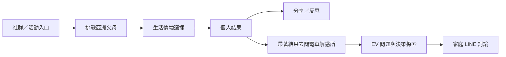
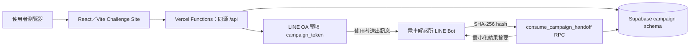

# 👨‍👩‍👧 挑戰亞洲父母

### 當「想換電動車」遇上亞洲家庭的每一句「可是……」

> **From EV curiosity to family consensus.**<br>
> 從「我想買電動車」，一路陪使用者走到「我們家可以一起討論」。

「挑戰亞洲父母」是這段旅程的 **engagement layer**：以低門檻、mobile-first 的家庭情境互動，讓原本難以開始的購車對話有個入口；完成後，使用者可分享結果，或帶著精簡結果脈絡前往 LINE「電車解惑所」，繼續探索 EV 決策問題。

**15 題情境挑戰 × 4 種家長魔王 × 9:16 分享卡 × LINE EV 決策延伸**

挑戰亞洲父母，讓家庭購車議題有一個願意開始的入口；電車解惑所，讓開始之後的疑問繼續談下去。

[▶ 開始挑戰](https://asian-parents-challenge.vercel.app) · [查看電車解惑所](https://github.com/WhiteChocolate0/toyota-ev-linebot)

## 為什麼從「亞洲父母」開始？

「亞洲父母」是幽默包裝，核心仍是跨世代溝通與家庭共同決策。高單價汽車牽涉資金、使用習慣、品牌信任與安全感；EV 疑慮也常要經過研究、家庭討論與持續解答，才走向決策。這個 journey 不只是看廣告，而是讓興趣有機會變成家庭對話。

## 核心體驗

| 階段 | 體驗 |
| --- | --- |
| 玩起來 | 登記 2–12 字暱稱後免登入；15 題、三階段，每題選 A／B／C。 |
| 看結果 | Server 依四個維度計分，呈現 MONEY、SAFETY、FACE、TRADITION 之一、魔王防禦值與溝通攻略。 |
| 分享 | 下載 9:16 魔王卡或分享固定 referral link，邀請朋友來玩；全站榜需 opt-in。 |
| 延伸 | 從結果頁前往 LINE「電車解惑所」，繼續 EV 問題探索。 |

挑戰圈不是好友系統：朋友透過分享連結加入並完成挑戰後即可解鎖排行；每人只以最新完成結果上榜。

## User Journey



進入挑戰並輸入暱稱 → 回答生活情境 → 累積四個維度 → 查看家長魔王結果 → 分享、邀請朋友 → 帶著結果到 LINE 延續 EV 對話。

## Quiz 是入口，AI 在後面的決策旅程

Challenge Site 維持快速、deterministic、可預期的互動；LINE「電車解惑所」承接自然語言理解、EV 問答與情境式決策支援。Persona 與精簡摘要只作對話脈絡，不作推薦硬條件。**Interactive Campaign + AI Decision Support.**

## 從活動到 LINE，不重新開始

完成測驗 → server 驗證結果 ownership → 建立短效 token → 開啟 LINE OA 預填訊息 → 使用者送出 `campaign_token` → Bot consume token 並取得精簡結果脈絡。

- Token 有效 15 分鐘、single-use、DB 僅存 SHA-256 hash；handoff 限 1 對 1。

細節見 [`docs/campaign_linebot_integration_contract.md`](docs/campaign_linebot_integration_contract.md)。

## 為什麼這對 TOYOTA 有價值？

- **Awareness → Engagement**：把 EV 從規格資訊轉成生活情境，讓使用者願意開始互動。
- **Engagement → Consideration**：結果頁把玩樂接到真實疑慮探索，而不是在測驗裡硬推車款。
- **Individual → Family**：使用者可把結果帶進 LINE 對話，讓高涉入的汽車選擇有機會回到家庭討論。

本作品為 **2026 和泰 AI 黑客松參賽作品**。

## Live Demo

- [▶ 開始挑戰](https://asian-parents-challenge.vercel.app) · [電車解惑所 repository](https://github.com/WhiteChocolate0/toyota-ev-linebot)

建議後續補上 Landing、Quiz、Result 與 LINE handoff 畫面截圖。

## 系統架構



網站與 Bot 的資料責任及 payload 見 [`docs/campaign_linebot_integration_contract.md`](docs/campaign_linebot_integration_contract.md)。

## Privacy & Safety

- 免登入匿名 participant；瀏覽器記住目前裝置的匿名身分與作答恢復資訊。
- 全站排行榜預設不公開，需使用者主動 opt-in。
- Handoff 驗證結果 ownership；DB 僅存 SHA-256 token hash。
- Supabase service-role key 僅供 server 使用，不進 browser bundle。

## Tech Stack

- React 18、TypeScript、Vite
- Vercel Functions（同一個 project、同源 `/api/*`）
- Supabase（`campaign` schema；server-side Supabase client）
- Vitest；另有少量 Python service／unittest
- Web Share、Canvas PNG 分享卡與 LINE OA deep link

## Quality

測試與部署 gate 涵蓋：

- Scoring、結果與 deterministic tie-break
- API routing、payload validation 與 result ownership
- Handoff token contract、分享與 referral
- 挑戰圈／全站排名與公開 opt-in
- `npm run predeploy`：tests、build、Function count gate

## Engineering Notes

因 Vercel Hobby 的 12 個 Serverless Functions 上限，API 依 domain 整併：**13 個 intended handlers → 7 個 function candidates**，並保留 LINE handoff 安全邊界。詳見 [`docs/vercel_function_inventory.md`](docs/vercel_function_inventory.md)。

## Current MVP Status

- 正式首頁可連線；完整社交與 LINE handoff E2E 尚未完成驗收。
- Contract 文件記錄共享 MVP DB 的 RPC function-body 更新與 live consume 尚未完成驗證；細節見 integration contract。
- 兩個 backend 使用 service-role credential，屬 MVP 接受風險；正式產品化前應縮小 DB 權限。
- 本作品驗證互動內容能否成為 EV 家庭決策入口，不是完整 CRM、正式 lead scoring 或 Toyota production platform；後續仍需 analytics、A/B testing、campaign integration 與更完整的 consent governance。

## Developer Setup

需安裝 Node.js、npm、Vercel CLI，並配置 Supabase server-side credentials。測 API 請使用 Vercel CLI；單獨 Vite 僅提供前端。

```bash
npm install
npm run dev:vercel
npm test
npm run build
npm run predeploy
```

本機入口為 `http://localhost:3000`，前端使用同源 `/api/*`。Runtime 需要 server-side `SUPABASE_URL`、`SUPABASE_SERVICE_ROLE_KEY`；LINE handoff 另需 `LINE_OA_BASIC_ID`。範例見 [`.env.development.example`](.env.development.example)；勿提交本機環境檔或 `.vercel/`。
